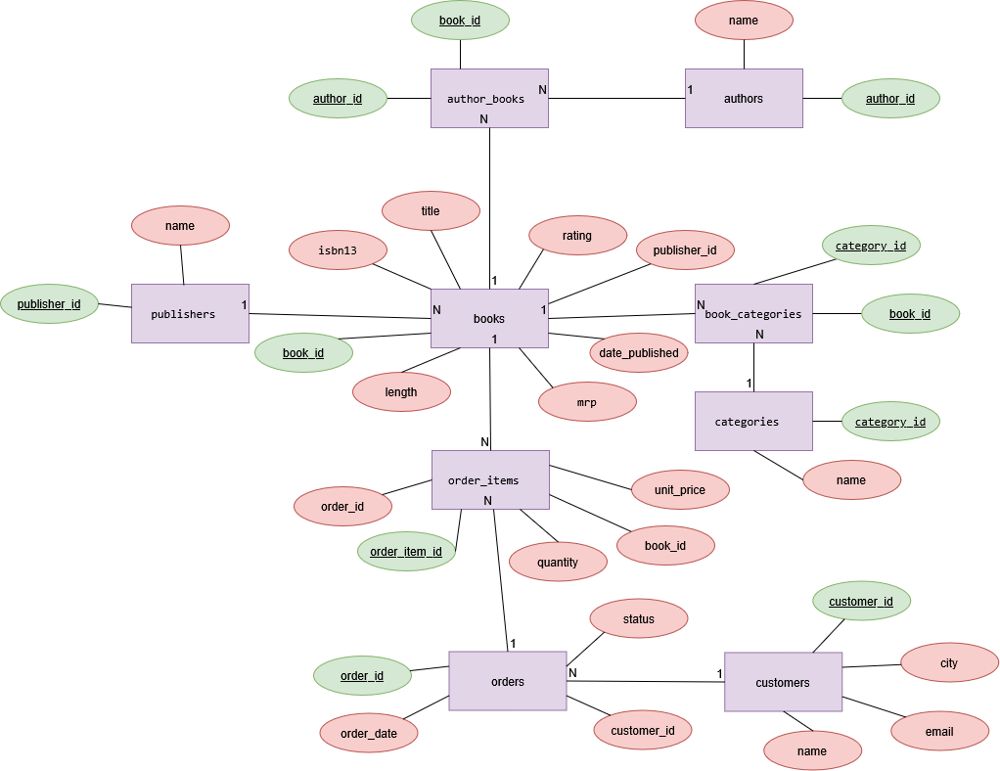
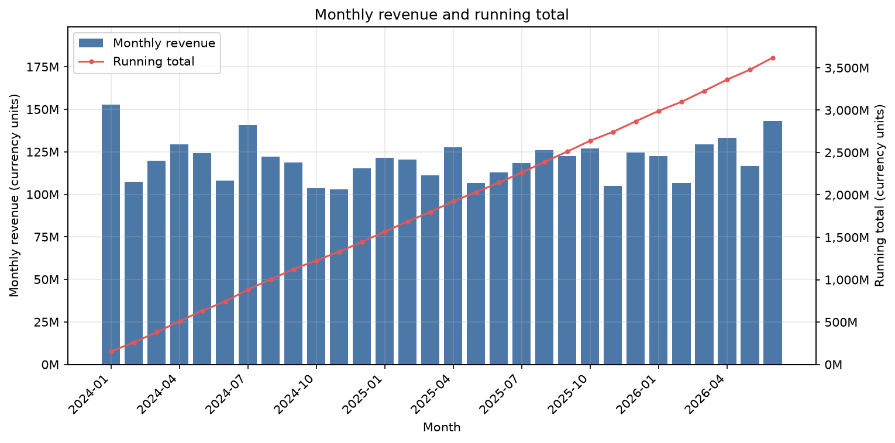
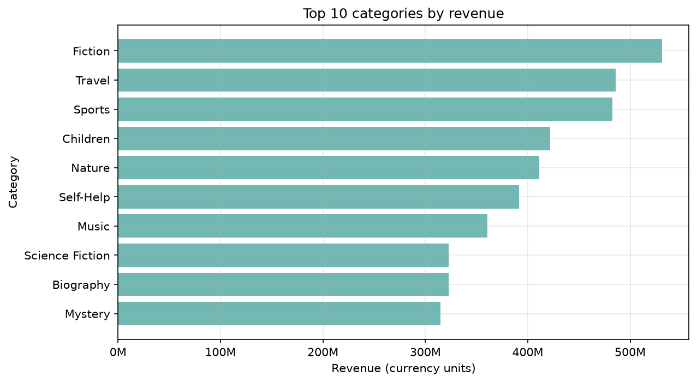

# SQL Bookstore Analytics

A PostgreSQL bookstore database with 9 tables, 12 analysis queries, indexes, views, an atomic `place_order` function, a Python/pandas notebook and 80 automated tests that run in CI.

[](https://github.com/Sheyda-Fathi/sql-bookstore-analytics/actions/workflows/tests.yml)


## Problem

A bookstore keeps connected data: books, authors, publishers, categories, customers and orders. Without a well-designed relational schema, the data becomes inconsistent (an order without items, a book without a publisher), and simple business questions ("which category brings the most revenue?") are hard to answer.

This project designs the schema, lets PostgreSQL enforce the rules, fills the database with reproducible synthetic data, and answers business questions with SQL and Python.

## Demo





## Tech stack

| Technology | Used for |
|---|---|
| PostgreSQL | schema, constraints, queries, indexes, views, PL/pgSQL function |
| Python 3.14 | seed script, database access, analysis |
| psycopg2 | PostgreSQL driver (all queries are parameterized) |
| pandas, Matplotlib, Jupyter | analysis notebook and charts |
| Faker | reproducible synthetic data (fixed seed) |
| pytest | 80 automated tests |
| GitHub Actions | CI with a disposable PostgreSQL service |

## Database design

Nine tables. The ER diagram is in [`docs/er_diagram.png`](docs/er_diagram.png) (editable source: [`docs/er_diagram.drawio`](docs/er_diagram.drawio)).

| Table | Purpose |
|---|---|
| `publishers`, `authors`, `categories` | catalog lookups |
| `books` | the catalog (title, price `mrp`, rating, ISBN, publisher) |
| `author_books`, `book_categories` | many-to-many junction tables with composite primary keys |
| `customers`, `orders`, `order_items` | sales: a customer places orders, an order has items |

Design decisions:

- **Third normal form.** Publisher data lives in `publishers`, not in every book row. Authors and categories are many-to-many, so they use junction tables.
- **Rules are enforced by the database,** not by Python: `CHECK` (price > 0, rating between 0 and 10, quantity > 0, order status in a fixed list), `UNIQUE` (ISBN, customer email, category name), `NOT NULL` (every book has a publisher) and foreign keys.
- **`ON DELETE`:** a publisher with books, a customer with orders and a book that was ordered cannot be deleted (`RESTRICT`); junction rows and order items disappear with their parent (`CASCADE`).
- **`order_items.unit_price` is a snapshot** of the price at purchase time, so changing a book's `mrp` does not change old orders.
- `authors.name` is one column, so single-name authors fit. The trade-off: searching by last name only is harder.

## SQL analysis

Twelve queries in [`sql/queries/`](sql/queries/), each with the business question at the top of the file.

| # | Question | Technique |
|---|---|---|
| 01 | Which 10 books have the highest price? | `ORDER BY`, `LIMIT` |
| 02 | How many books does each publisher have? | `LEFT JOIN`, `GROUP BY` |
| 03 | How many orders are in each status? | `GROUP BY` |
| 04 | Authors and publisher of every book | 4-table `JOIN` |
| 05 | Revenue per category | multi-table `JOIN`, aggregation |
| 06 | The 5 customers who spent the most | `JOIN`, `GROUP BY`, `LIMIT` |
| 07 | Publishers with more than 45 books | `HAVING` |
| 08 | Categories with an average rating of at least 7.55 | `HAVING`, `AVG` |
| 09 | Customers who spent more than the average customer | CTE, subquery |
| 10 | Best-selling book of each publisher | window function (`RANK`) |
| 11 | Monthly revenue and running total | CTE, window function (`SUM() OVER`) |
| 12 | Books that were never ordered | `LEFT JOIN ... IS NULL` |

Revenue means `quantity * unit_price` and excludes cancelled orders.

### Indexes and `EXPLAIN ANALYZE`

PostgreSQL does not index foreign-key columns automatically. [`sql/02_indexes.sql`](sql/02_indexes.sql) adds six indexes, and [`scripts/benchmark_indexes.py`](scripts/benchmark_indexes.py) measures six queries before and after (median of 9 runs, PostgreSQL 18.3):

| Query | Before (plan) | Before (ms) | After (plan) | After (ms) | Speed-up |
|---|---|---|---|---|---|
| Sales rows of one book | Seq Scan on order_items | 0.554 | Bitmap Heap Scan on order_items | 0.048 | 11.5x |
| Orders of one customer | Seq Scan on orders | 0.258 | Bitmap Heap Scan on orders | 0.018 | 14.3x |
| Books of one publisher | Seq Scan on books | 0.155 | Bitmap Heap Scan on books | 0.033 | 4.7x |
| Books of one category | Seq Scan on book_categories | 0.263 | Bitmap Heap Scan on book_categories | 0.041 | 6.4x |
| Authors of one book | Seq Scan on author_books | 0.153 | Index Scan on author_books | 0.009 | 17.0x |
| Order lines of one customer (3-table join) | Seq Scan on order_items, Seq Scan on orders, Index Scan on books | 1.367 | Bitmap Heap Scan on orders, Index Scan on order_items, Index Scan on books | 0.082 | 16.7x |

The database is small (about 10,000 order lines), so the times are fractions of a millisecond. The main result is the plan change from a full table scan to an index lookup. Full output: [`docs/index_benchmark.md`](docs/index_benchmark.md).

### Views and a function

[`sql/03_views_functions.sql`](sql/03_views_functions.sql):

- `v_book_full_info`: one row per book with its publisher, all authors and all categories (authors and categories are collected in two separate sub-queries, so books are not repeated).
- `v_order_totals`: one row per order with the customer, number of lines and total amount.
- `place_order(customer_id, book_ids[], quantities[])`: creates an order and all its lines in one atomic call. An unknown book, a quantity of 0 or arrays of different length roll everything back, so there is never an order without items.

## Python analysis

[`notebooks/analysis.ipynb`](notebooks/analysis.ipynb) reads the saved queries from `sql/queries/` into pandas through [`src/bookstore/analysis.py`](src/bookstore/analysis.py) and draws four charts (saved in [`reports/figures/`](reports/figures/)). Values are always passed to SQL as parameters (`%s`), never with f-strings.

Key findings (from the seeded data, cancelled orders excluded):

- Total revenue: **3,620,195,600** currency units across 5,000 orders; **6.9%** of the orders are cancelled.
- Best month: **2024-01** with 152,655,500.
- Top category: **Fiction** (530,930,200).
- Top customer: Valerie Romero, 12,784,800 in 10 orders.
- 179 of 2,000 books have no rating.



## Quick Start

Requirements: Python 3.14 (the version used in development and in CI), PostgreSQL 18 and Git.

```bash
git clone https://github.com/Sheyda-Fathi/sql-bookstore-analytics.git
cd sql-bookstore-analytics

python -m venv .venv
source .venv/bin/activate          # Windows: .venv\Scripts\activate
pip install -r requirements.txt

cp .env.example .env               # Windows: copy .env.example .env
# edit .env: set DB_PASSWORD (and DB_HOST / DB_PORT if needed)

psql -U postgres -c "CREATE DATABASE bookstore;"
psql -U postgres -d bookstore -v ON_ERROR_STOP=1 -f sql/01_schema.sql
python -m src.bookstore.seed
psql -U postgres -d bookstore -v ON_ERROR_STOP=1 -f sql/02_indexes.sql
psql -U postgres -d bookstore -v ON_ERROR_STOP=1 -f sql/03_views_functions.sql

python -m pytest -q
```

The order matters: schema, then seed, then indexes and views. To run one analysis query:

```bash
psql -U postgres -d bookstore -f sql/queries/05_revenue_by_category.sql
```

Then open `notebooks/analysis.ipynb`, select the `.venv` kernel and run all cells. The seed uses a fixed random seed, so everyone gets the same data and the same numbers.

`.env` is ignored by Git and must never be committed. `.env.example` only lists the variable names.

## Testing

80 tests, all run against a real PostgreSQL database:

| Area | Tests |
|---|---|
| Schema rules (`CHECK`, `NOT NULL`, `UNIQUE`, foreign keys, `ON DELETE`) | 35 |
| Seeded data (row counts, every book has an author and a category, no order before publication) | 16 |
| Dataset generator (no database needed: same seed gives the same data) | 9 |
| Database connection and error handling | 5 |
| Views and the `place_order` function | 8 |
| Analysis helpers | 5 |
| Indexes (every foreign-key column is indexed) | 1 |
| The notebook runs from the first cell to the last | 1 |

Tests that write data run inside a transaction that is always rolled back, so they never change the seeded data. The constraint tests check the exact constraint that rejected the data, so they fail if a rule is removed or weakened.

## Continuous integration

[`.github/workflows/tests.yml`](.github/workflows/tests.yml) starts a disposable PostgreSQL service on GitHub Actions, builds the database in the order above, and runs the whole test suite. It uses test-only credentials and no secrets.

## Project structure

```text
sql-bookstore-analytics/
├── .github/workflows/tests.yml
├── docs/                      # ER diagram, index benchmark
├── notebooks/analysis.ipynb
├── reports/figures/           # charts used in this README
├── scripts/benchmark_indexes.py
├── sql/
│   ├── 01_schema.sql
│   ├── 02_indexes.sql
│   ├── 03_views_functions.sql
│   └── queries/               # 12 analysis queries
├── src/bookstore/             # db.py, seed.py, analysis.py
├── tests/
├── .env.example
├── pytest.ini
├── requirements.txt
└── README.md
```

## What I learned

- Foreign keys are not indexed automatically in PostgreSQL; `EXPLAIN ANALYZE` showed the difference.
- A `CHECK` accepts `NULL`; only `NOT NULL` stops a missing value.
- `SERIAL` sequences are not rolled back, so a test or script must never hard-code ids.
- A window function cannot be used in `WHERE`; the ranking goes in a CTE and the filter in an outer query.
- Joining two many-to-many tables in one query repeats rows; aggregate each side separately.
- Parameterized queries keep user input as data (SQL injection demo: the f-string version returned every row, the parameterized version returned none).
- A multi-step write belongs in one transaction or function, so it either fully happens or not at all.
- A seed must be reproducible and re-runnable: fixed seeds, `TRUNCATE ... RESTART IDENTITY`, one transaction, sequences synced afterwards.

## Limitations and future work

- The data is synthetic (Faker with a fixed seed), so the findings describe the generator, not a real shop. Ratings are random and about 9% are missing on purpose.
- There is no currency in the schema and no inventory, so `place_order` does not check stock.
- Category revenue counts a book once in each of its categories, so the category totals add up to more than the real total.
- The database is small, so index speed-ups are measured in fractions of a millisecond; a larger dataset would show a bigger absolute difference.
- CI tests one Python and one PostgreSQL version.
- Possible next steps: a `reviews` table to analyze ratings over time, materialized views for heavy reports, and full-text search on book titles.

## Author

Sheyda Fathi · [GitHub](https://github.com/Sheyda-Fathi)